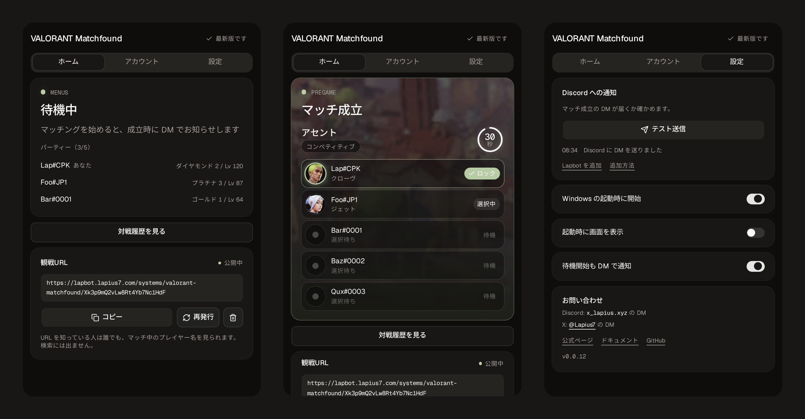

# Valorant Matchfound

[English](README.md) | 日本語

VALORANT のマッチが成立した瞬間に、Discord へ DM でお知らせする Windows のタスクトレイアプリです。DM にはモード、マップ、味方のエージェントのピックが載り、試合が終わるまで自動で書き換わります。



> **非公式のツールです。** 個人が作ったもので、Riot Games とは関係なく、公認も支援も受けていません。VALORANT は Riot Games, Inc. の商標です。

## 機能

- **マッチ成立を DM で通知。** Lapbot 経由で届くので、パソコンから離れていても気づけます。
- **更新される Embed。** モード、マップ画像、残り時間、各プレイヤーのピック(選択中・ロック)が同じメッセージに反映されます。試合中、終了も自動で切り替わります。
- **観戦用 URL。** アプリから URL を発行すると、知っている人はマッチをリアルタイムで見られます。再発行も削除もいつでもできます。検索エンジンには載りません。
- **再起動に強い。** メッセージ ID を保存するので、アプリや bot を再起動しても同じメッセージを更新します(消えていれば作り直します)。
- **自動アップデート。** 起動時と6時間ごと、タスクトレイからも確認できます。インストーラーが起動中のアプリを自分で閉じます。
- **静かに常駐。** Windows 起動時に開始でき、VALORANT が起動すると見張りを始めます。

## インストール

1. [Releases](https://github.com/Lapius7/valorant-matchfound/releases/latest) からインストーラーをダウンロードします。
2. 実行して、アプリを開きます。
3. [Lapbot をアカウントに追加](https://discord.com/oauth2/authorize?client_id=1470053949263577189&integration_type=1&scope=applications.commands)します(ユーザーインストール)。DM を受け取るために必要です。
4. **設定**タブでログインを押し、ブラウザで [Lapount](https://account.lapius7.com/dashboard) のアカウントを承認します。Lapount に Discord が連携されている必要があります。
5. **テスト送信**で DM が届くか確かめます。届かないときは、Discord のプライバシー設定で Lapbot からの DM を許可してください。

Windows 10 以降の 64 ビット版に対応しています。

## しくみ

```
VALORANT - Riot Client ローカル API -> アプリ -> Lapbot API -> Discord DM
                                         \-> 観戦ページ (SSE) -> 閲覧者
```

- 自分の presence を Riot Client のローカル API(lockfile 経由)から読み、エージェント選択中は自分のアカウントのプレゲーム情報を読みます。ゲーム画面やメモリは読まず、ゲームのプロセスにも触れません。
- 名前や画像は [valorant-api.com](https://valorant-api.com) から取得します。
- ログインは Lapount のデバイスコード方式です。保存するのは refresh token とメールアドレスだけで、Windows の資格情報マネージャーに入ります。
- Lapbot API に送るのはマッチ情報(モード、マップ、プレイヤー名とエージェント)だけで、DM の編集に使われます。
- 状態の変化は `%APPDATA%\com.lapius7.valorant-matchfound\logs\states.log` に記録されます(Riot 側の形式が変わったときの調査用)。

## 観戦用 URL

ホームタブの「観戦URL」カードで `https://lapbot.lapius7.com/systems/valorant-matchfound/<token>` を発行します。

- 1人につき URL は1つです。**再発行**で古い URL は無効になり、**削除**でページは全員に対して閉じます。
- URL を知っている人は、今のマッチのプレイヤー名を見られます。公開の場に貼らないでください。
- ページは `noindex`、`no-referrer`、`no-store` を返します。

## プライバシー

| データ | 送り先 |
| --- | --- |
| マッチ情報(モード、マップ、プレイヤー名、エージェント) | Lapbot API。そこから Discord の DM と観戦ページへ |
| 終了した試合の結果(マップ、各プレイヤーの名前・エージェント・K/D/A・ACS、ランク増減) | Lapbot のサーバー(MySQL)に保存し、同じ試合を取り直さないための共有と、サイトの対戦履歴に使います。VALORANT への問い合わせを減らす目的です |
| Lapount の refresh token とメールアドレス | 自分の PC の資格情報マネージャー |
| 利用者数 | ログイン中にアプリが動いている間、5秒ごとに Lapbot へ ping を送ります。インストール数とオンライン数の表示と、不具合の調査のため、Lapount ID・Discord ID・初回と最後に使った時刻・ping と DM の回数を保存します。人数の推移は匿名の集計だけを公開し、個人ごとの情報は開発者だけが見られます |
| Riot の認証情報 | 自分の PC で Riot と通信するときだけ使い、Lapbot には送りません |

## 利用規約について

自分のアカウントで見られる情報だけを使い、ゲームの自動操作や改変はしません。ただし Riot の製品ではないため、利用は自己責任でお願いします。

## ソースからビルド

pnpm と Rust が必要です。WSL からのクロスビルドなら `x86_64-pc-windows-gnu` ターゲットも入れます。

```bash
pnpm install
pnpm build                                   # cargo の前に必須
cd src-tauri
cargo build --release --target x86_64-pc-windows-gnu
```

インストーラーは [Inno Setup 6](https://jrsoftware.org/isinfo.php) で作ります。

```bash
ISCC.exe /DAppVersion=0.0.10 installer/valorant-matchfound.iss
```

構成: Tauri v2、Rust、React、Vite、Tailwind CSS v4、shadcn/ui。

## ライセンス

[MIT](LICENSE) (c) Lapius7
