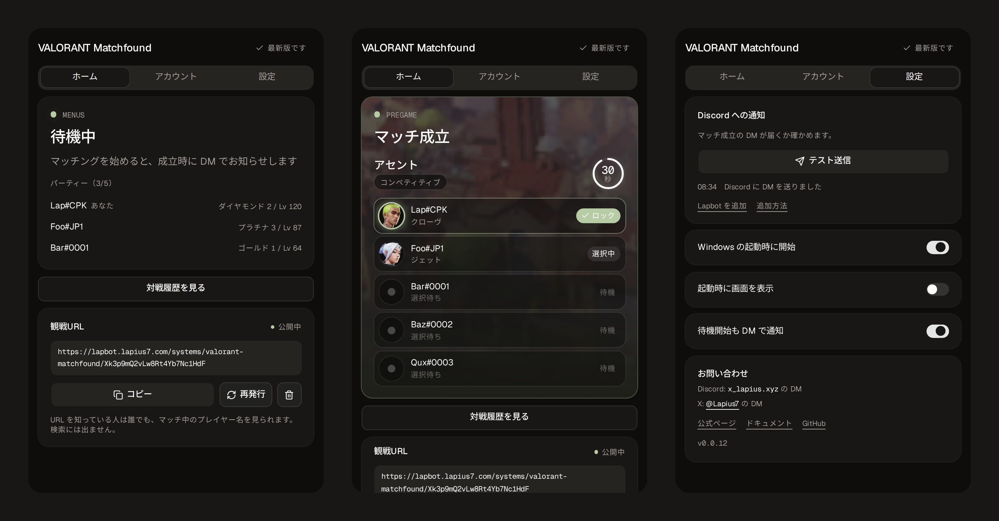

# Valorant Matchfound

English | [日本語](README.ja.md)

A Windows tray app that sends you a Discord DM the moment a VALORANT match is found. The DM shows the mode, the map and each teammate's agent pick, and it keeps updating until the match ends.



> **Unofficial.** This is a personal project. It is not made, endorsed or supported by Riot Games. VALORANT is a trademark of Riot Games, Inc.

## Features

- **DM on match found.** You are notified through Lapbot, even when you are away from the PC.
- **Live Embed.** Mode, map image, remaining time and each player's pick (selecting / locked) are edited into the same message. It switches to "in game" and "ended" by itself.
- **Share URL.** Issue a URL from the app and anyone who has it can watch the match in real time. You can regenerate or delete it at any time. The page is hidden from search engines.
- **Restart safe.** The message ID is saved, so restarting the app or the bot continues the same message (a lost message is recreated).
- **Auto update.** Checks on start, every 6 hours, and from the tray menu. The installer closes the running app by itself.
- **Quiet tray app.** Can start with Windows and begins watching when VALORANT starts.

## Install

1. Download the installer from [Releases](https://github.com/Lapius7/valorant-matchfound/releases/latest).
2. Run it and open the app.
3. Install [Lapbot](https://discord.com/oauth2/authorize?client_id=1470053949263577189&integration_type=1&scope=applications.commands) to your Discord account (user install). It is needed to receive DMs.
4. On the **Settings** tab, press the login button and approve it in your browser with your [Lapount](https://account.lapius7.com/dashboard) account. A Discord account must be linked to Lapount.
5. Press **Test DM** to check that a message arrives. If it does not, allow DMs from Lapbot in your Discord privacy settings.

Requires Windows 10 or later (64-bit).

## How it works

```
VALORANT - Riot Client local API -> app -> Lapbot API -> Discord DM
                                      \-> share page (SSE) -> viewers
```

- The app reads your own presence from the Riot Client local API (through its lockfile) and, during agent select, the pre-game match of your own account. It never reads the game screen or memory and does not touch the game process.
- Names and images come from [valorant-api.com](https://valorant-api.com).
- Login uses Lapount's device-code flow. Only the refresh token and your email are stored, in Windows Credential Manager.
- The app sends only match information (mode, map, players' names and agents) to the Lapbot API, which edits the DM.
- State changes are logged to `%APPDATA%\com.lapius7.valorant-matchfound\logs\states.log` (for diagnosing Riot format changes).

## Share URL

The **Share URL** card on the Home tab issues `https://lapbot.lapius7.com/systems/valorant-matchfound/<token>`.

- One URL per user. **Regenerate** invalidates the old one, **Delete** closes the page for everyone.
- Anyone who knows the URL can see the player names of your current match. Do not post it publicly.
- The page sends `noindex`, `no-referrer` and `no-store`.

## Privacy

| Data | Where it goes |
| --- | --- |
| Match info (mode, map, player names, agents) | Lapbot API, then your Discord DM and the share page |
| Lapount refresh token and email | Windows Credential Manager on your PC |
| Usage count | While the app runs and you are logged in, it pings Lapbot every 5 seconds. Your Lapount ID, Discord ID, first/last-seen times and ping/DM counts are kept for the install and online counts and for troubleshooting. Only anonymous totals are public; per-user details are visible to the developer only |
| Riot credentials | Used only to talk to Riot on your PC. Never sent to Lapbot |

## Terms of service

The app only uses information available to your own account and does not automate or modify the game. Even so, it is not a Riot product, and you use it at your own risk.

## Build from source

Requires pnpm, Rust, and, for cross builds from WSL, the `x86_64-pc-windows-gnu` target.

```bash
pnpm install
pnpm build                                   # frontend, required before cargo
cd src-tauri
cargo build --release --target x86_64-pc-windows-gnu
```

The installer is built with [Inno Setup 6](https://jrsoftware.org/isinfo.php):

```bash
ISCC.exe /DAppVersion=0.0.8 installer/valorant-matchfound.iss
```

Stack: Tauri v2, Rust, React, Vite, Tailwind CSS v4, shadcn/ui.

## License

[MIT](LICENSE) (c) Lapius7
